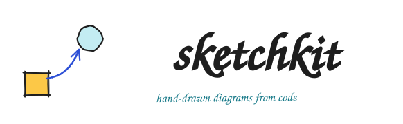

<p align="center">
  <picture>
    <source media="(prefers-color-scheme: dark)" srcset="docs/logo-dark.svg">
    
  </picture>
</p>

# sketchkit

Composable hand-drawn SVG diagrams, one idea per drawing. Pure Python, no dependencies.

```python
from sketchkit import *

a, b = Box("client"), Box("server")
svg = Diagram(
    Row(a, b, gap=90), 
    edges=[Arrow(a, b, "request")],
    headline="one request, one answer"
).svg()
```

You never write coordinates. Boxes size themselves from their text, containers place them, and arrows find the box outlines.

## Setup (uv)

```bash
cd sketchkit
uv sync
uv run pytest
uv run mypy
uv run pyright
uv run python examples/demo.py --no-write --gallery out/gallery.html
```

## For agents (and people in a hurry)

```bash
uv run python -m sketchkit guide          # how to draw good diagrams: shapes, recipes, design rules
uv run python -m sketchkit api            # every public name and signature, generated from the code
uv run python -m sketchkit check FILE.py  # lay out a script's diagrams and report layout problems
```

`Diagram.check()` returns `Issue`s: overlapping shapes, arrows through boxes or on top of each other, labels on shapes, text that doesn't fit, content too wide, too many colors, and a missing title or headline. Each issue names the parts involved and suggests a fix, so an agent that can't see the SVG can still correct it. Diagram scripts also accept `--check`.

- [AGENTS.md](AGENTS.md) covers working on the library itself. `CLAUDE.md` imports it. [CONTRIBUTING.md](CONTRIBUTING.md) covers issues and pull requests.
- **Claude Code skill.** [`sketch-diagrams`](src/sketchkit/skills/sketch-diagrams/SKILL.md) walks Claude Code through illustrating a Markdown document: load the guide, pick a shape, write the script, check it, insert it. It ships in the package. To add it to a project, run this from the project's folder:

  ```bash
  uv run python -m sketchkit skill --install            # writes .claude/skills/sketch-diagrams/SKILL.md
  ```

  `skill` alone prints it. `--install DIR` writes it somewhere else, such as `~/.claude/skills` for every project. An installed copy you've edited is only replaced with `--force`.

## Types

The package ships `py.typed`. It passes both mypy `--strict` and pyright `strict`.

- **Every option is a `Literal`**, so `align="middle"` or `theme="dark"` is rejected before anything runs. This covers style, theme, align, justify, route, label side, mark kind and tone names.
- **Modifiers return `Self`**, so `Box("a").tone("bad").dashed()` is still typed as `Box`.
- **Inputs have named aliases** for the argument shapes the idea functions accept: `Child`, `Ref`, `BoxSpec`, `EventSpec`, `PanelSpec`, `CellSpec` and `SetSpec`.
- **`Doc.diagram` only accepts builders that return a `Diagram` or `Canvas`.**
- **Meaning names you define (`"traitor"`) are plain strings**, so the type checker can't check them. They are checked when the diagram renders, and an unknown name raises an error listing the known ones.


From another project: `uv add --editable ../sketchkit`, or `uv add git+<repo-url>` once it is in a repo.

## The model

A diagram is a tree of **nodes**. **Edges** point at nodes and are drawn after layout.

| | |
|---|---|
| **Leaves** | `Box(title, sub)`, `Label`, `Headline`, `Note`, `Step(n, text)`, `Cell`, `Circle`, `Dot`, `Mark("check"/"cross")`, `Spacer`, `Free(w, h, fn)` |
| **Layout** | `Row`, `Col` (`gap`, `align`, `justify`, `stretch`), `Grid`, `Split` (panels + divider), `Overlay`, `Pad`, `Region(title, child)` |
| **Scales** | `Track(At(value, item), ...)` timelines; `Lanes(lanes, rows)` with `Msg` / `Act` / `Gap` sequence diagrams |
| **Edges** | `Arrow(a, b, label, tone, dashed, route="hv"/"vh", via=[...])`, `Line`, `Bracket(nodes, label, side)` |
| **Footer** | `Diagram(..., headline=, note=, legend=True)` |

**Modifiers** change the node and return it, so they chain: `.tone("bad")`, `.dashed()`, `.fixed(w, h)`, `.align("start")`, `.link(*edges)`, `.pad(...)`.

**Ports**: an arrow can start or end at a point on a node: `node.top`, `.bottom`, `.left`, `.right`, `.center`, or `.at(fx, fy)`.

**`.link()`** attaches edges to a node. A function can return a part that carries its own arrows, and you can drop it anywhere in a tree.

## Ideas: common shapes, built from nodes

`flow`, `stack`, `timeline`, `sequence`, `compare`, `table`, `overlap`, `steps`, `hub`. Each one returns an ordinary node, so they nest:

```python
Split(
    Col(steps("propose", "replicate", "commit"), stack("etcd API", "raft", "WAL")),
    Region("one node", hub("leader", ["f1", "f2", "f3"])),
)
```

To add your own idea, write a function that returns a node. `generals()` in [examples/demo.py](examples/demo.py) is one, and `compare()` uses it twice.

## Meanings, not colors

Nodes say what something *is*, and the render call maps that to color:

```python
Box("leader").tone("traitor")
diagram.svg(meanings={"loyal": "cyan", "traitor": "orange"})   # adds to good/bad/wait/normal
```

The tones are `cyan`, `orange`, `rust` and `slate`, plus `accent` and `soft`. `Legend()` (or `legend=True`) lists only the meanings the diagram uses.

## Rendering

`diagram.svg(style="hand"|"clean", theme="paper"|"auto"|"blog")`

- **paper**: an Excalidraw-like card that looks the same in light and dark readers.
- **auto**: follows the reader's theme (Obsidian, GitHub).
- **blog**: CSS classes for a site stylesheet.

Randomness is seeded per node, so editing one box doesn't redraw the wobble of every other line.

## Into Markdown

```python
doc = Doc("post.md", theme="paper", meanings={...})

@doc.diagram("fencing", "caption")       # goes after <!-- sketch: fencing -->
def fencing():
    return Diagram(...)

run(doc)   # --preview DIR  --gallery FILE  --no-write  --clean  --theme T
```

Re-running replaces the figures it inserted before, and keeps the file's line endings.

## Layers

- `sketchkit.core`: the pen and the coordinate `Canvas`.
- `sketchkit.nodes`: nodes, layout, edges, `Diagram`.
- `sketchkit.ideas`: the shapes above.
- `sketchkit.publish`: `Doc`, `run`, `gallery`.

Text width is estimated from a per-character table, not measured from font files. Check new diagrams with `--preview` or `--gallery`.
