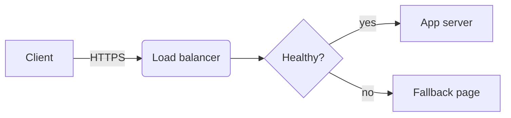
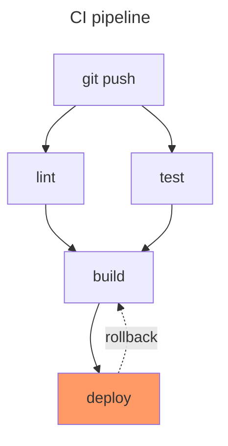
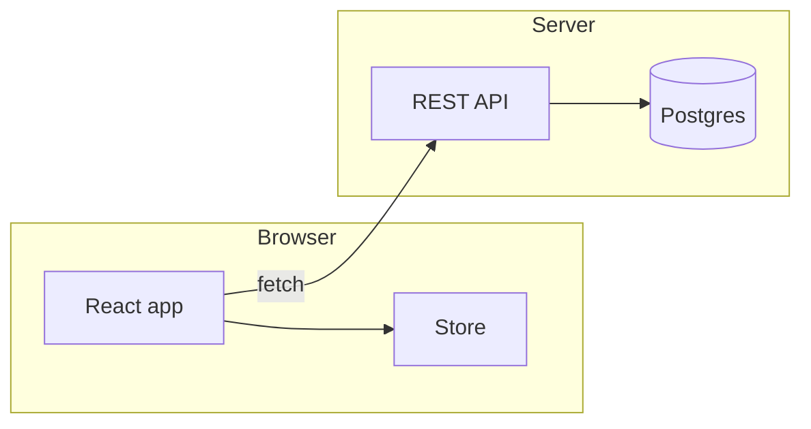
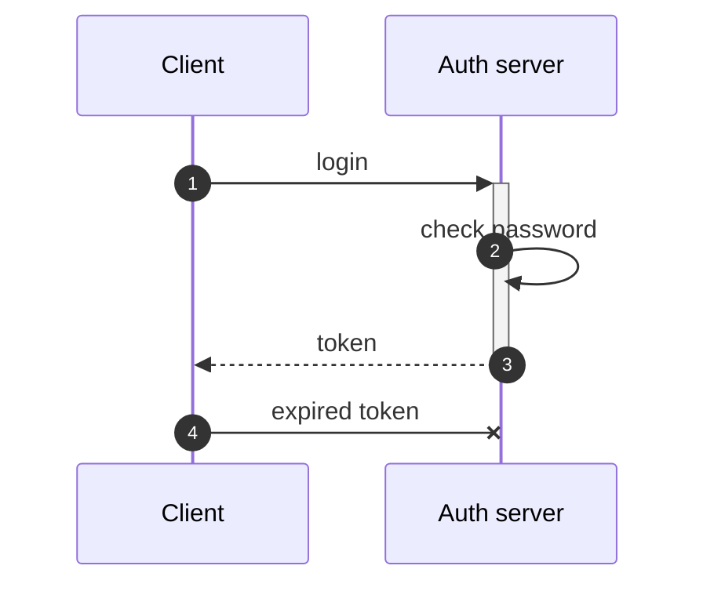
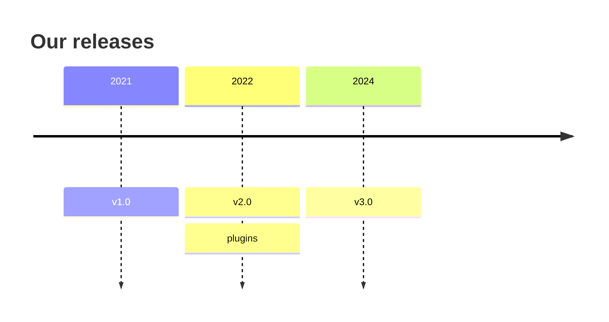

# Coming from Mermaid

If you write diagrams in Mermaid, you already know most of Penflow. Arrows, labels, `[text]` boxes, `:::classes`, `participant` and `->>` work the way you expect. This page shows what changes, then how to move a post over in two commands.

## Why switch

- **Hand-drawn diagrams that explain one idea**, with a headline, a note and a legend that lists only the meanings the drawing uses.
- **Meanings, not colours.** You write `:::bad` and `meanings: {bad: orange}` once per post, and every diagram in the post agrees.
- **A checker.** `python -m penflow check post.md` lays the diagrams out and reports overlapping boxes, arrows through boxes, labels on shapes and text that doesn't fit, each with the line and a fix. That's what makes it work for an agent that can't see the picture.
- **Short to write.** The Penflow syntax is close to Mermaid's length, and about half the tokens of the same diagram built in Python.

## Move a post over

```bash
python -m penflow convert post.md            # print what each ```mermaid fence becomes
python -m penflow convert post.md --write    # replace the mermaid fences with penflow fences
python -m penflow check post.md              # fix anything it reports
python -m penflow render post.md             # draw the figures into the post
```

To try it without changing the post, `render post.md --mermaid` and `check post.md --mermaid` draw the ` ```mermaid ` fences as they are, converting them on the fly. Errors and check issues then point at lines in the Mermaid fence.

Anything the converter couldn't carry over exactly is listed at the top of the new fence as a `%% converted from Mermaid: ...` comment, and printed by `convert`. Read those comments, then delete them.

## Side by side

Each Penflow block below is exactly what `convert` prints for the Mermaid above it. A test checks that they stay in sync.

### A flowchart



```penflow
%% converted from Mermaid: decision shapes drawn as boxes
flow lr
  a[Client] -->|HTTPS| b[Load balancer]
  b --> c[Healthy?]
  c -->|yes| d[App server]
  c -->|no| e[Fallback page]
```

- **Ids are snake_case**, and the Mermaid id stays as the label: `A` becomes `a[A]`. Write your own ids in lowercase and the label can often go: `client` is drawn as "client".
- **There are no shape variants** (`{decision}`, `[(cylinder)]`, `>flag]`). They become boxes, and a circle stays a circle. In Penflow the tone carries the meaning, not the outline.
- **The layout is done for you.** Branches, merges and loops are laid out in ranks, as in Mermaid.

### Classes, fan-out and a loop



```penflow
---
headline: CI pipeline
meanings: {prod: orange}
---
flow td
  push[git push] --> lint
  push --> test
  lint --> build
  test --> build
  build --> deploy:::prod
  deploy -.->|rollback| build
```

- **`classDef` becomes a meaning.** Its fill colour picks the nearest of Penflow's four tones: orange, cyan, rust or slate. The `style` and `linkStyle` lines, which set colours directly, are dropped.
- **`A & B` becomes one edge line per edge.**
- **The Mermaid `title` becomes the `headline`**, which is the line under the drawing that says what to take away. Rewrite it as a sentence: "a failed deploy rolls back to the last build".
- **The edge back to `build` is drawn around the flow**, not through it.

### Subgraphs



```penflow
%% converted from Mermaid: cylinder shapes drawn as boxes
row {gap: 40}
  region Browser
    flow td
      ui[React app] --> store[Store]
  region Server
    flow td
      api[REST API] --> db[Postgres]
ui -->|fetch| api
```

- **A subgraph becomes a `region`.** Blocks end where the indentation ends, so there's no `end`.
- **Regions are ordered by the edges between them.** Their contents run across the outer direction, so edges can leave without crossing other nodes. Give a subgraph a `direction` to keep its own.
- **Edges between regions go at the top level**, after the body.

### A sequence diagram



```penflow
%% converted from Mermaid: messages to self drawn as notes beside the lane
%% converted from Mermaid: dashed messages drawn solid
sequence_diagram
  participant c[Client]
  participant s[Auth server]
  note s: "" {bar: 4}
  c ->> s: ① login
  note s: ② check password
  s ->> c: ③ token
  c -x s: ④ expired token
```

- **The name changes to snake_case:** `sequenceDiagram` becomes `sequence_diagram`.
- **`participant C as Client` becomes `participant c[Client]`**, using the same `[label]` as boxes.
- **`Note right of S: text` becomes `note s: text`.** A note always sits beside its lane.
- **An activation becomes a `bar`** on a note: the empty `note s: ""` row above, with `{bar: 4}` covering the next rows.
- **`autonumber` becomes ①②③ in the labels**, which you can edit.
- **`loop`, `alt`, `opt` and `par` aren't drawn,** but their messages are kept, in order. Dashed replies (`-->>`) are drawn solid for now.

### A timeline



```penflow
---
headline: Our releases
---
timeline
  2021: 2021\nv1.0
  2022: 2022\nv2.0\nplugins
  2024: 2024\nv3.0
```

Numeric periods are positions on the axis, so 2024 sits twice as far from 2022 as 2022 is from 2021. Periods that aren't numbers (`Q1`, `Q2`) are spaced evenly. `section` lines are dropped.

## Not converted

`convert` refuses these Mermaid types, and the message names the closest Penflow block:

| Mermaid | closest in Penflow |
|---|---|
| `gantt`, `gitGraph` | `timeline` |
| `stateDiagram` | `flow`, with states as nodes and transitions as edges |
| `classDiagram`, `erDiagram` | a `grid` of boxes, with edges |
| `pie`, `xychart` | `table` |
| `journey` | `steps` |
| `mindmap` | `hub` |
| `C4Context`, `architecture` | `region` blocks with a `flow` inside |

## Things that are different on purpose

- **Every keyword is snake_case,** and so are ids, attribute keys and front-matter keys. There's one spelling for everything, which makes it easier to write by hand and for an LLM to get right.
- **One diagram, one idea.** A diagram with more than 15 shapes gets a warning, and the fix is to split it into two fences.
- **Attributes instead of styles:** `{gap: 60}`, `{dashed}`, `{label_side: below}`, `{w: 200}`. They are the keyword arguments of the Python API, and an unknown one is an error that lists the valid ones.
- **Templates for repeated parts:** `template name(params)` and `use name as copy {param: value}`. Mermaid has nothing like them. See the guide (`python -m penflow guide`).

The full syntax is in [language.md](language.md).
